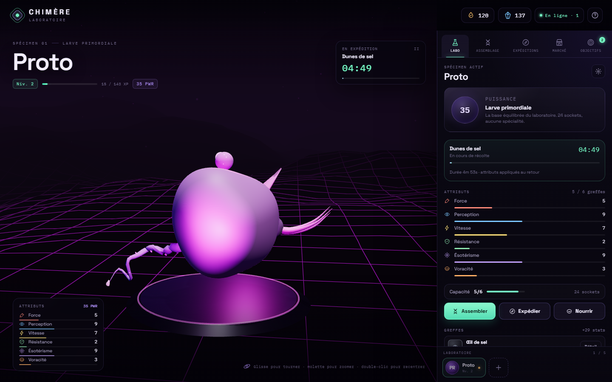
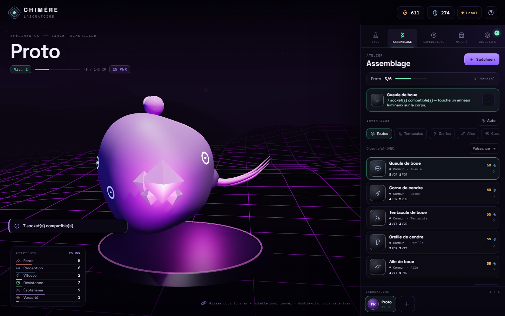
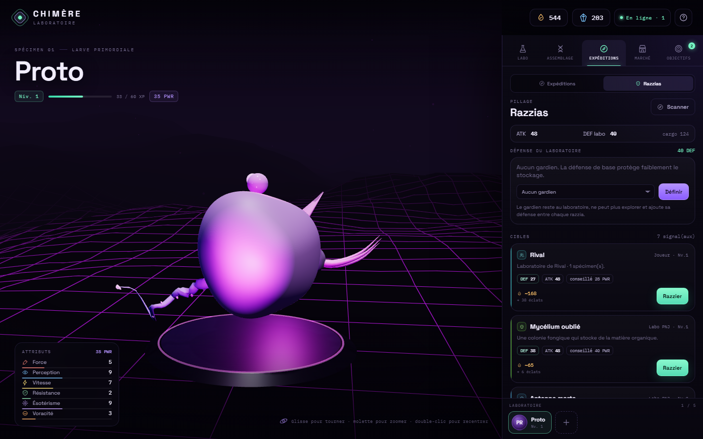
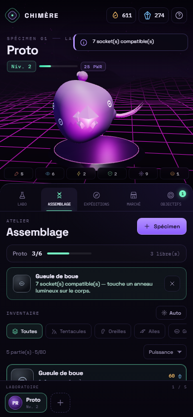

# CHIMÈRE — Laboratoire de monstres

Un jeu idle multijoueur où l'on récolte des **parties de corps** (yeux, cornes,
tentacules, ailes…), où on les **greffe en 3D** sur une créature, puis où on
l'envoie **explorer** un monde vivant. Les attributs du monstre décident du
butin ; le marché partagé permet d'échanger le surplus, et les **razzias**
permettent de piller le laboratoire d'un rival.

> **Boucle** : récolter → assembler → renforcer → échanger → piller.
> Le design complet, les formules et les tableaux d'équilibrage sont dans
> [GAME_LOOP.md](GAME_LOOP.md).



<p align="center">
  
  
</p>

<p align="center">
  
</p>

## Déjà jouable

- **Drop** : 10 types de parties, 4 raretés, butin et rareté pilotés par les stats.
- **Builder 3D** : 24 à 26 sockets, greffe/détache au clic, auto-assemblage,
  rotation du spécimen, aperçu procédural unique par partie.
- **Six attributs** : Force, Perception, Vitesse, Résistance, Ésotérisme, Voracité.
- **Idle** : 5 zones de 1 min à 2 h, expéditions simultanées, butin hors ligne.
- **Niveau** : XP par expédition ou en nourrissant le monstre avec de la biomasse ;
  chaque niveau ajoute un socket et +2 % de stats.
- **Razzias** : attaque de labos PNJ ou de joueurs réels, défense figée au départ,
  butin de ressources, fatigue en cas d'échec. Aucun monstre ni aucune partie
  n'est détruit.
- **Gardien** : un monstre dédié à la défense du laboratoire, qui ne peut plus
  partir en mission et ajoute sa DEF à celle du labo.
- **Tourelle de veille** : trois niveaux d’amélioration payés en biomasse et
  éclats ; son bonus de DEF s’applique aussi aux cibles multijoueur.
- **Marché** : annonces, prix libres, taxe, collectionneurs PNJ, ventes hors ligne.
- **Multijoueur** : sauvegardes, marché et razzias partagés via un petit serveur
  Node sans dépendance, mises à jour temps réel en SSE.
- **Objectifs** : sept contrats de départ qui donnent une direction aux
  premières sessions.
- **Mobile** : interface en feuille basse, HUD compact, mode paysage.

## Démarrer

### Multijoueur (recommandé)

Double-clique sur **`start-game.bat`**, ou en terminal :

```bat
cd "C:\Users\enzom\Documents\Threejs Monstre"
node server.js
```

Puis ouvre **http://localhost:8787**.

Le serveur affiche aussi une adresse réseau (`http://192.168.x.x:8787`) pour
jouer depuis un téléphone sur le même Wi-Fi. Les données sont dans `data/db.json`
(créé au premier lancement).

> Node.js n'est pas installé globalement sur cette machine : le `.bat` utilise
> automatiquement le Node fourni par l'environnement DSH s'il est présent.
> Sinon, installe Node.js 18+.

### Solo (marché et razzias PNJ simulés, aucun serveur)

```bat
python -m http.server 8000
```

Puis **http://localhost:8000**. Le jeu fonctionne entièrement hors ligne avec le
marché et les six labos PNJ locaux.

### Sans terminal

`start-solo.bat` lance le serveur statique Python et ouvre le navigateur.

## Commandes

- **Glisser sur le monstre** : le faire tourner.
- **Molette / pincement** : zoom.
- **Double-clic** : recentrer la rotation.
- **Onglet Assemblage** : toucher une partie de l'inventaire, puis un anneau
  lumineux sur le corps. Les anneaux violets sont libres, les verts compatibles.
- **Clic sur une greffe** : fiche détaillée, retrait.
- **Nourrir** : convertit 4 biomasse en 1 XP (minimum 10).
- **Expéditions → Razzias** : choisir une cible, lancer, résoudre au retour.
  « Définir » dans la carte Gardien nomme le défenseur du labo ; la Tourelle de
  veille s’améliore en échange de biomasse et d’éclats dans cette même carte.
- **Marché** : prix libre ; un collectionneur achète rapidement sous ~130 % du
  prix conseillé, sinon l'annonce expire et l'objet revient.

## Structure

```
index.html               coquille de l'application
css/style.css            interface sombre responsive
js/data.js               équilibrage : parties, raretés, corps, zones, objectifs
js/economy.js            moteur pur : stats, loot, prix, expéditions
js/raid.js               moteur pur : attaque, défense, butin, labs PNJ
js/state.js              état, sauvegarde, actions, marché local, razzias locales
js/net.js                client serveur, SSE, sauvegarde distante, marché/razzias
js/ui.js                 HUD, onglets, modales, toasts, timers
js/scene.js              scène Three.js, caméra, picking des sockets
js/monsterBuilder.js     assemblage procédural à partir des sockets
js/partGenerator.js      génération 3D des 10 types de parties
js/icons.js              icônes SVG inline
server.js                serveur HTTP + SSE sans dépendance
data/db.json             sauvegardes, annonces et razzias actives (généré)
tools/                   captures headless, simulation, scripts de scénarios
```

Le moteur (`data.js`, `economy.js`, `raid.js`, `state.js`) ne dépend ni du DOM
ni de Three.js. Il est testé sous Node et réutilisé par le serveur pour valider
le marché et les razzias.

## Tests

```bash
node tests/engine.test.js      # moteur + razzias locales (18 tests)
node tests/server.test.mjs     # serveur, marché et razzias (8 tests)
node tools/simulate.mjs        # simulation de progression
```

Le test serveur lance son propre processus sur un port isolé, avec une base
temporaire et des razzias accélérées (`CHIMERE_RAID_MULT`, `CHIMERE_RAID_MIN_MS`).

## Notes

- Three.js et les polices viennent d'un CDN : connexion internet au premier
  chargement.
- Le multijoueur est un **prototype** : identité par jeton local, pas de mot de
  passe ; les sauvegardes hors marché/razzia sont client-authoritative, le
  marché et les razzias sont validés côté serveur. Voir les limites dans
  [GAME_LOOP.md](GAME_LOOP.md).
- Le mode solo reste prioritaire : si le serveur n'est pas joignable, tous les
  boutons continuent de fonctionner avec le marché et les labos PNJ locaux.
